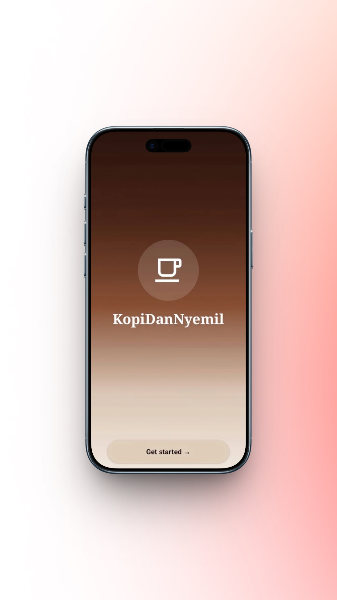
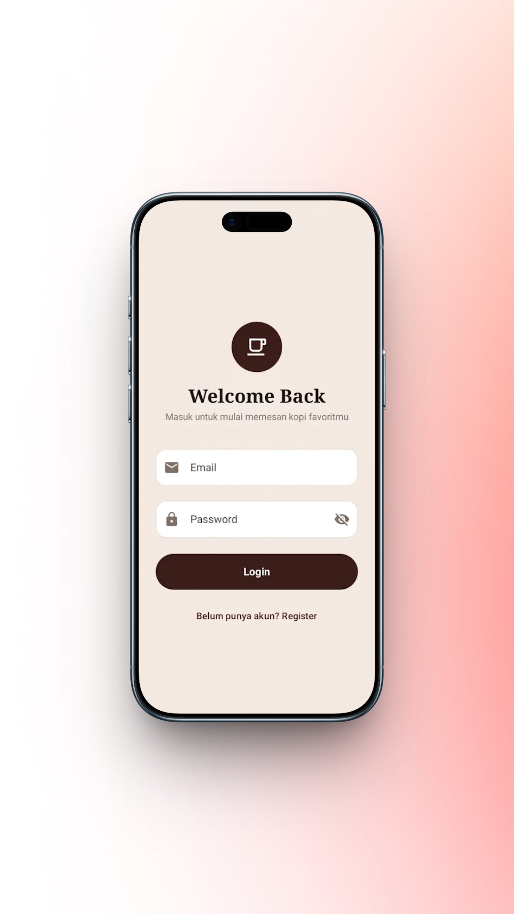
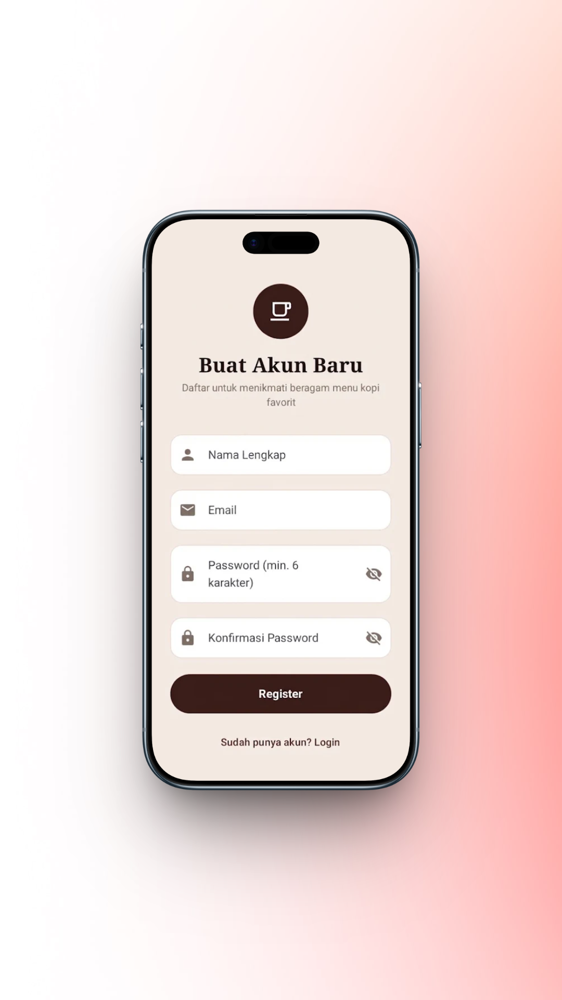
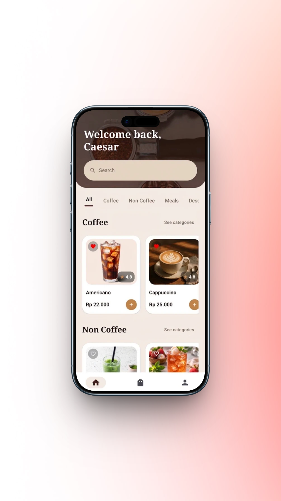

# ☕ Kopi dan Nyemil - Mobile Application

Aplikasi pemesanan kopi dan camilan berbasis Android yang dibangun dengan **Jetpack Compose** dan arsitektur modern **MVVM**. Aplikasi ini dibuat berdasarkan wireframe resmi **"Kopi dan Nyemil"** untuk memenuhi ketentuan tugas pemrogramaan aplikasi mobile.

---

## 📋 Daftar Isi
- [Tentang Aplikasi](#-tentang-aplikasi)
- [Fitur Utama](#-fitur-utama)
- [Teknologi yang Digunakan](#-teknologi-yang-digunakan)
- [Struktur Data Dummy](#-struktur-data-dummy)
- [Alur Layar (Wireframe Compliance)](#-alur-layar-wireframe-compliance)
- [Cara Menjalankan Aplikasi](#-cara-menjalankan-aplikasi)
- [Tangkapan Layar (Screenshots)](#-tangkapan-layar-screenshots)

---

## ☕ Tentang Aplikasi

**Kopi dan Nyemil** adalah aplikasi mobile intuitif yang memudahkan pengguna untuk menjelajahi beragam pilihan minuman kopi, non-kopi, makanan berat (*meals*), hingga camilan manis (*desserts*). Aplikasi ini dilengkapi dengan kustomisasi ukuran (*cup size*), varian rasa, estimasi harga dinamis, hingga alur pemesanan dan konfirmasi pengiriman yang lengkap.

---

## ✨ Fitur Utama

1. **Splash & Welcome Screen**: Layar pembuka elegan dengan logo kafe dan tombol *Start Now*.
2. **Sign Up Choice Screen**: Layar pilihan awal untuk melanjutkan ke Registrasi atau Login.
3. **Autentikasi (Login & Register)**:
   - Form Login & Registrasi lengkap dengan validasi input.
   - *IME Padding* otomatis sehingga input password tidak tertutup keyboard.
4. **Beranda & Katalog Produk (Home)**:
   - Header melengkung bergaya *aesthetic* dengan motif biji kopi.
   - Pencarian produk (*Search Bar*) secara *real-time*.
   - Tab kategori interaktif (**All**, **Coffee**, **Non Coffee**, **Meals**, **Desserts**, **Orders**).
   - *See Categories* interaktif untuk langsung berpindah ke tab kategori.
   - *Product Card* menarik lengkap dengan badge rating (★), harga Rupiah, dan tombol favorit (❤️).
5. **Halaman Detail Produk (Product Detail)**:
   - Gambar produk *full-bleed* dengan sudut melengkung.
   - Pilihan ukuran (*Short, Tall, Grande, Regular, Large*) yang mengubah harga secara **dinamis**.
   - Pilihan rasa (*Hazelnut, Caramel, Vanilla, dll.*).
   - Pengatur kuantitas jumlah pesanan (*stepper* `-` / `+`).
6. **Detail Pesanan & Troli (Order Review / Cart)**:
   - Rincian item yang dibeli sebelum lanjut ke alamat pengiriman.
   - Fitur ubah jumlah item langsung dari keranjang.
7. **Pengisian Alamat Pengiriman (Delivery Address)**:
   - Form nama penerima, alamat, dan detail/patokan lokasi.
   - Kartu form kontras yang jelas dan mudah dibaca.
8. **Konfirmasi Pesanan (Confirmation)**:
   - Animasi sukses pemesanan.
   - **Rincian lengkap item** yang dibeli (foto, nama, ukuran, jumlah, dan total harga per item).
9. **Profil Pengguna (Profile)**:
   - Pengaturan nama profil pengguna.
   - Fitur Logout.

---

## 🛠️ Teknologi yang Digunakan

- **Bahasa Pemrograman**: Kotlin 2.2+
- **UI Framework**: [Jetpack Compose](https://developer.android.com/jetpack/compose) (Material3)
- **Arsitektur**: MVVM (Model-View-ViewModel) dengan Compose State
- **Desain UI**: Custom Theme (`WarmBeige`, `DarkBrownHeader`, `CaramelGold`, `DarkButton`)
- **Aset Gambar**: Android Vector Drawables (`.xml`) & Local Drawable Resources (`.png` / `.jpg`)
- **Min SDK**: 24 (Android 7.0 Nougat)
- **Target SDK**: 37 (Android 15)

---

## 📂 Struktur Data Dummy

Aplikasi ini tidak memerlukan database eksternal dan menggunakan **data statis (Dummy Data)** yang tersimpan di dalam project:

📍 **Lokasi File**: `app/src/main/java/com/kopinyemil/app/AppViewModel.kt`  
📍 **Objek Data**: `object DummyData`

`DummyData` memuat 18 item produk statis yang dikelompokkan ke dalam 4 kategori:
- ☕ **Coffee**: *Caffe Americano, Cappuccino, Caramel Macchiato, Cold Brew*
- 🍵 **Non-Coffee**: *Matcha Latte, Lychee Tea, Thai Tea, Mango Tea, Red Velvet Latte*
- 🥪 **Meals (Makanan Berat)**: *Beef Croissant Sandwich, Nasi Goreng Special, Spaghetti Carbonara, Chicken Katsu Curry*
- 🥐 **Desserts (Makanan Ringan)**: *Chocolate Cookies, Butter Croissant, Fudge Brownies, Blueberry Muffin, Bagel & Donut*

---

## 🗺️ Alur Layar (Wireframe Compliance)

Aplikasi telah mengimplementasikan seluruh alur yang ada pada wireframe resmi:

```
[1. Splash / Welcome] ──> [2. Sign Up Choice] ┬──> [3. Login User] ────┐
                                              └──> [4. Register] ──────┴──> [5. Home] ──> [Detail Produk]
                                                                              │
[8. Konfirmasi Pesanan] <── [7. Alamat Pengiriman] <── [6. Detail Pesanan / Cart] <┘
```

---

## 🚀 Cara Menjalankan Aplikasi

1. **Clone Repository**:
   ```bash
   git clone https://github.com/reyrayvha/KopiDanNyemil.git
   ```
2. **Buka di Android Studio**:
   - Buka Android Studio (versi Ladybug / 2024.2+ direkomendasikan).
   - Pilih **Open** dan arahkan ke folder `KopiDanNyemil`.
3. **Build & Sync**:
   - Tunggu hingga Gradle Sync selesai secara otomatis.
4. **Run Aplikasi**:
   - Hubungkan HP Android melalui USB Debugging atau gunakan Android Emulator.
   - Klik tombol **Run** (`Shift + F10`) di Android Studio.

---

## 📷 Tangkapan Layar (Screenshots)

*(Tambahkan screenshot tampilan aplikasi kamu di sini setelah di-push ke GitHub)*

| Welcome / Splash | Sign Up Choice | Login Screen | 
| :---: | :---: | :---: |
|  |  |  |

| Register Screen | Home Screen |
| :---: |  :---: |
|  |  |

| Detail Produk | Detail Pesanan | Alamat Pengiriman | Konfirmasi Pesanan |
| :---: | :---: | :---: | :---: |
|  |  |  |  |

---

*Dikembangkan untuk Tugas Aplikasi Mobile - Kopi dan Nyemil ☕*
